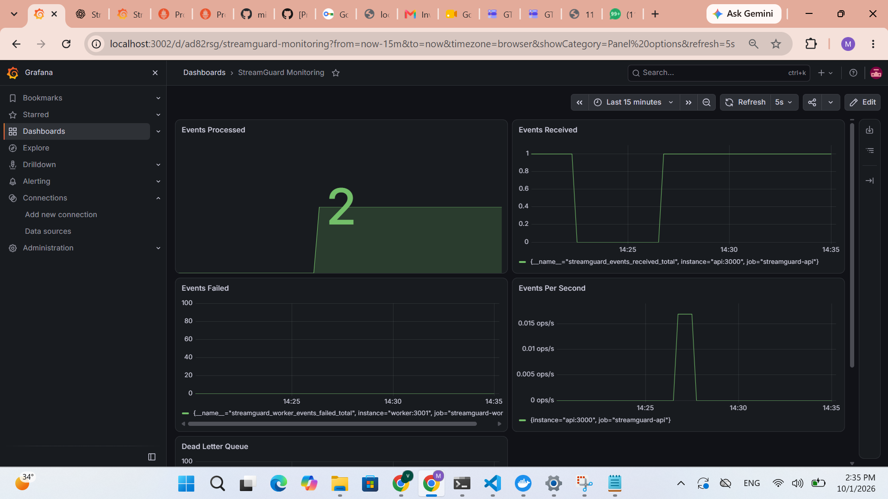
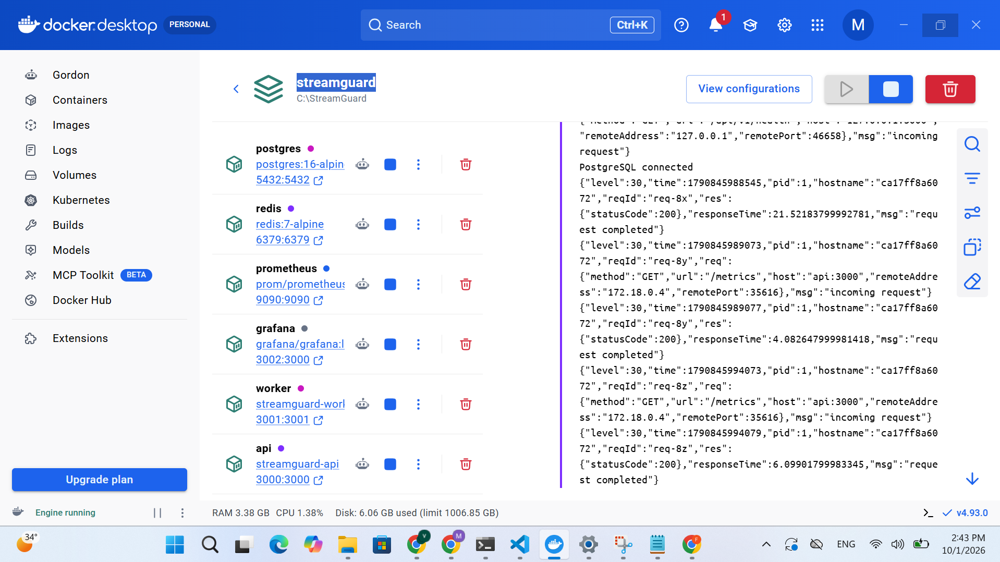
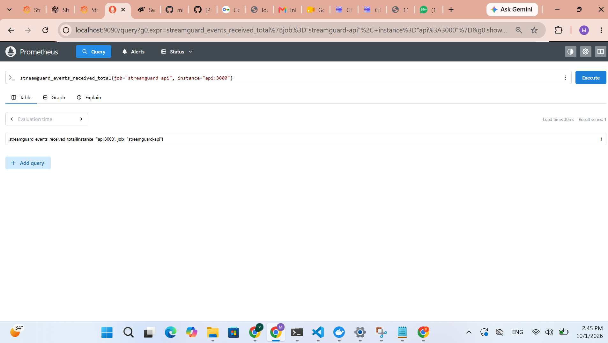
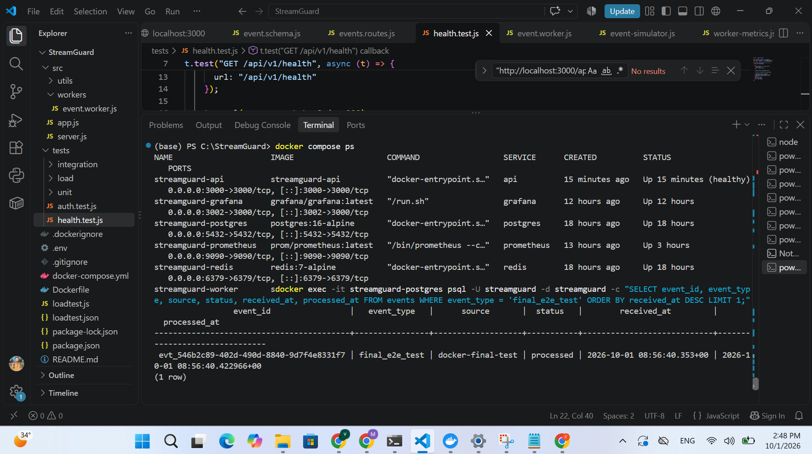

# StreamGuard

**StreamGuard** is a distributed event ingestion pipeline built with Node.js, Fastify, Redis, BullMQ, PostgreSQL, Docker, Prometheus, and Grafana.

The system follows a producer-consumer architecture where the API accepts events quickly and asynchronous workers process them through a Redis-backed queue before persisting them to PostgreSQL.

## Architecture

```text
Client / Event Simulator
          |
          v
   Fastify REST API
          |
          v
     Redis / BullMQ
          |
          v
      Worker Pool
          |
          v
      PostgreSQL

Observability:

API + Worker
     |
     v
 Prometheus
     |
     v
  Grafana

Key Features
- Asynchronous event ingestion using Redis and BullMQ
- Producer-consumer architecture
- Concurrent background event processing
- Batched PostgreSQL inserts
- PostgreSQL JSONB event storage
- Idempotency using event IDs
- Automatic retries with exponential backoff
- Dead Letter Queue (DLQ)
- DLQ inspection and manual retry APIs
- API key authentication
- Request rate limiting
- Request validation
- Centralized error handling
- Graceful API and worker shutdown
- Prometheus metrics
- Grafana monitoring dashboard
- Swagger / OpenAPI documentation
- Dockerized development environment
- Automated API health and authentication tests
- Local event simulator
- HTTP load testing with Autocannon
Technology Stack
Technology    Purpose
Node.js    Backend runtime
Fastify    REST API framework
Redis    Queue backend
BullMQ    Distributed job queue
PostgreSQL    Persistent event storage
Docker    Containerization
Prometheus    Metrics collection
Grafana    Metrics visualization
Swagger / OpenAPI    API documentation
Tap    Automated testing
Autocannon    HTTP load testing


Event Processing Flow
1. A client sends an event to the StreamGuard API.
2. Fastify validates the request.
3. API authentication is performed using an API key.
4. The event is assigned an event ID.
5. The API places the event into the BullMQ processing queue.
6. The API immediately returns HTTP 202 Accepted.
7. Worker processes consume events asynchronously.
8. Events are buffered and written to PostgreSQL in batches.
9. Successful events are marked as processed.
10. Failed jobs are retried automatically.
11. Events that exhaust all retry attempts are moved to the Dead Letter Queue.
12. DLQ events can be inspected and manually retried.
API Endpoints
Health Check
GET /api/v1/health
Checks PostgreSQL, Redis, and Dead Letter Queue availability.
Event Ingestion
POST /api/v1/events
Required header:
x-api-key: <API_KEY>
Example:
{
  "eventType": "order.created",
  "source": "event-simulator",
  "payload": {
    "orderId": "ORD-1001",
    "customerId": "CUST-101",
    "amount": 2500
  }
}

Successful response:
{
  "status": "accepted",
  "eventId": "evt_example",
  "message": "Event accepted for processing"
}

The endpoint returns HTTP 202 Accepted because processing happens asynchronously.
Dead Letter Queue
GET /api/v1/dlq
Returns events that failed processing after all configured retry attempts.
Retry DLQ Event
POST /api/v1/dlq/:jobId/retry
Moves a failed event back into the main processing queue.
Metrics
GET /metrics
Exposes Prometheus metrics from the API.
API Documentation
Swagger UI:
http://localhost:3000/docs
Monitoring
Prometheus:
http://localhost:9090
Grafana:
http://localhost:3002
Important metrics:
- streamguard_events_received_total
- streamguard_worker_events_processed_total
- streamguard_worker_events_failed_total
- streamguard_dead_letter_queue_size
The Grafana dashboard tracks:
- Events Received
- Events Processed
- Events Failed
- Dead Letter Queue Size
- Event ingestion rate
Load Testing
StreamGuard was benchmarked using Autocannon against the event ingestion endpoint.
Test configuration:
- Duration: approximately 10 seconds
- Connections: 10
- HTTP method: POST
- Endpoint: /api/v1/events
Observed API ingestion benchmark:
Requests:        17,863
Successful:      17,863
HTTP 202:        100%
Average RPS:      1,786.4
Average latency: 5.11 ms
P99 latency:      20 ms
Maximum latency: 96 ms

These numbers represent API ingestion throughput, not verified end-to-end processing throughput.
The benchmark was performed with rate limiting temporarily adjusted for testing.
Docker
The project runs as a local containerized stack using Docker Compose.
Services:
- streamguard-api
- streamguard-worker
- streamguard-redis
- streamguard-postgres
- streamguard-prometheus
- streamguard-grafana
Start:
docker compose up --build

Check:
docker compose ps

Stop:
docker compose down

Environment Variables
Create a .env file:
PORT=3000

REDIS_HOST=127.0.0.1
REDIS_PORT=6379

POSTGRES_HOST=127.0.0.1
POSTGRES_PORT=5432
POSTGRES_DB=streamguard
POSTGRES_USER=streamguard
POSTGRES_PASSWORD=streamguard_password

API_KEY=your-development-api-key

The .env file is excluded from Git.
Running Locally
npm install

Start API:
npm start

Start worker:
npm run worker

Development mode:
npm run dev

Testing
Automated tests cover:
- API health endpoint
- PostgreSQL availability
- Redis availability
- API key authentication
- Missing API key handling
- Invalid API key handling
- Successful authenticated event ingestion
Run:
npm test

Event Simulator
The project includes a local event simulator for generating application events without requiring an external e-commerce application.
Simulator:
scripts/event-simulator.js
The simulator can be used for:
- Functional testing
- Queue testing
- Worker testing
- Monitoring demonstrations
- Load testing preparation
Reliability Design
Asynchronous Processing
The API does not wait for PostgreSQL processing before responding to the client.
This reduces request latency and allows the system to absorb traffic spikes.
Retry Mechanism
BullMQ automatically retries failed jobs using exponential backoff.
Configured attempts:
3 attempts
Dead Letter Queue
Jobs that continue failing after all retry attempts are moved to a dedicated DLQ.
Idempotency
Events use unique event IDs and PostgreSQL uniqueness constraints to prevent duplicate event creation.
Batch Processing
Workers buffer events and write multiple events to PostgreSQL in a single database operation.
Graceful Shutdown
API and worker processes close their resources gracefully during shutdown.
Observability Architecture
                 StreamGuard
                     |
          +----------+----------+
          |                     |
        API                   Worker
          |                     |
          +----------+----------+
                     |
                 Prometheus
                     |
                  Grafana

Security
StreamGuard implements:
- API key authentication
- Request validation
- Rate limiting
- Centralized error handling
- Environment-based configuration
- Secrets excluded from Git
For production deployment, dedicated secret management should be used instead of a local .env file.
Current Status
The current implementation includes:
- REST event ingestion
- Redis/BullMQ queue
- PostgreSQL persistence
- Worker pool
- Batch database writes
- Retry and DLQ handling
- Authentication
- Rate limiting
- Validation and error handling
- Health checks
- Graceful shutdown
- Swagger documentation
- Prometheus metrics
- Grafana dashboard
- Docker Compose deployment
- Automated tests
- API load testing
Future Improvements
- Horizontal worker scaling
- Kafka-based ingestion
- Kubernetes deployment
- Redis Cluster
- PostgreSQL partitioning
- Advanced alerting
- Distributed tracing
- OpenTelemetry integration
- k6 load testing
- CI/CD pipeline
- Cloud deployment
- Production-grade secret management
Project Structure
StreamGuard/
├── monitoring/
│   └── prometheus.yml
├── scripts/
│   ├── event-simulator.js
│   └── loadtest.js
├── src/
│   ├── config/
│   │   ├── postgres.js
│   │   └── redis.js
│   ├── database/
│   │   ├── repositories/
│   │   │   └── event.repository.js
│   │   └── schema.sql
│   ├── metrics/
│   │   ├── metrics.js
│   │   └── worker-metrics.js
│   ├── middleware/
│   │   └── auth.js
│   ├── queues/
│   │   ├── event.queue.js
│   │   └── dead-letter.queue.js
│   ├── routes/
│   │   ├── events.routes.js
│   │   ├── health.routes.js
│   │   └── dlq.routes.js
│   ├── schemas/
│   │   └── event.schema.js
│   ├── workers/
│   │   └── event.worker.js
│   ├── app.js
│   └── server.js
├── tests/
│   ├── health.test.js
│   └── auth.test.js
├── Dockerfile
├── docker-compose.yml
├── loadtest.js
├── package.json
├── package-lock.json
└── README.md

Author
Minhaaz Ahmad
Software Engineer focused on backend development, AI engineering, and intelligent automation.

## 📸 Screenshots

### Swagger API Documentation

StreamGuard exposes an OpenAPI/Swagger interface for exploring and testing the available API endpoints, including authentication, event ingestion, health checks, and Dead Letter Queue operations.


### Grafana Monitoring Dashboard

The Grafana dashboard provides real-time visibility into event processing, received events, failures, events per second, and Dead Letter Queue activity.



### Dockerized Infrastructure

The complete StreamGuard stack runs through Docker Compose with API, worker, Redis, PostgreSQL, Prometheus, and Grafana services.



### Prometheus Metrics

Prometheus collects and exposes StreamGuard application metrics from the API and worker services.



### End-to-End Event Processing

The event ingestion flow was verified end-to-end from the API through the queue and worker into PostgreSQL, where the test event was recorded with processed status.


